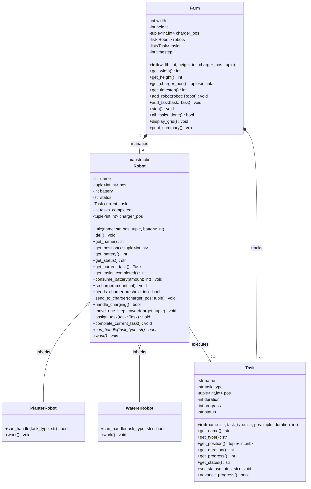

# FRA143 Final Project: Farm Robot Simulation

A discrete-timestep 2D grid simulation of autonomous farming robots built with Object-Oriented Programming (OOP) in Python.

## Simulation Overview
- **Grid World:** $10 \times 5$ 2D farm grid containing a Solar Charging Station (`C`), active crop tasks (`*`), and autonomous robots (`1`, `2`, `3`).
- **Robots (2 Types):**
  - `PlanterRobot`: Moves to `PLANT` tasks and plants crops (consumes 2% battery per work step).
  - `WatererRobot`: Moves to `WATER` tasks and irrigates crops (consumes 1% battery per work step).
- **Extra Feature (Low-Battery Recharging):** When an idle robot's battery drops to `25%` or below, it prioritizes navigating to the Charging Station `C` at `(0, 0)` and recharges (`+25%` per timestep, capped at `100%`) before accepting new tasks.

## How to Run & Test
1. **Run the simulation:**
   ```bash
   main.py
   ```
2. **Run unit tests:**
   ```bash
   pytest
   ```

## Class Diagram


## OOP Concepts in Code
| OOP Concept | Implementation Location |
| :--- | :--- |
| **Encapsulation** | Private attributes (`__battery`, `__pos`, `__status`, `__progress`) in `Robot`, `Task`, and `Farm` are modified only through validated methods such as `consume_battery()` (`>= 0`) and `recharge()` (`<= 100`). |
| **Inheritance** | `PlanterRobot` and `WatererRobot` inherit shared state, movement, and charging logic from the abstract base class `Robot`. |
| **Polymorphism** | `Farm.step()` iterates over a single `list[Robot]` and calls `robot.work()` on each instance without checking `type(robot)`. |
| **Composition** | `Farm` owns and coordinates collections of `Robot` and `Task` objects throughout the simulation lifecycle. |
| **Constructor & Destructor** | `__init__()` initializes valid object states across all classes, and `Robot.__del__()` releases task references upon cleanup. |