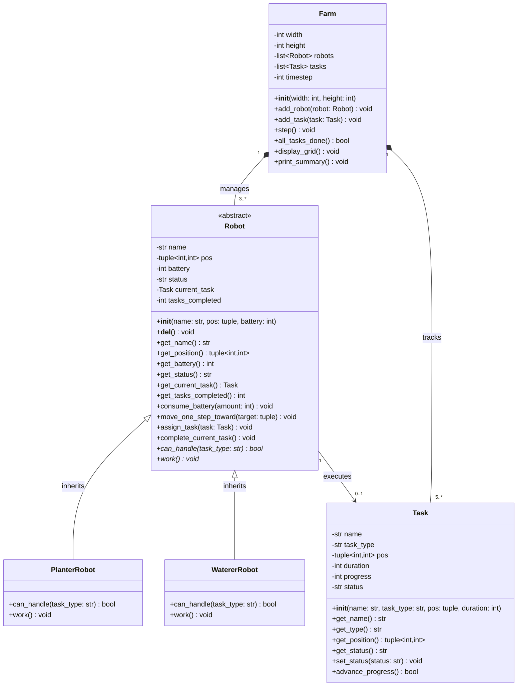

# This repository is for FRA143 Project which is a robot simulation 
This project is in development by Thanakrit Kulrattanarak and Jirat Sinchuen for FRA143 class.
The requirement of this project can be seen in file [Final_Project_Robot_Simulation](Final_Project_Robot_Simulation.pdf)\
The scenario for the robot work is it's in a farm

## Class Diagram
